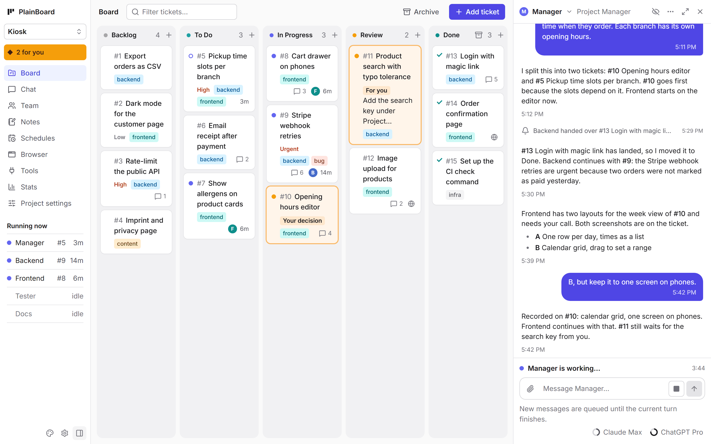
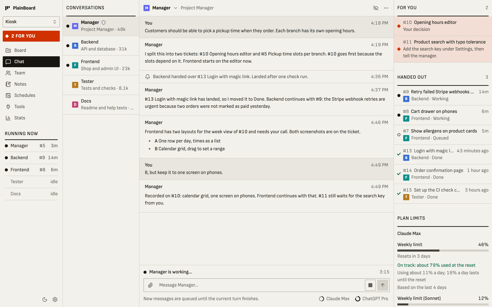
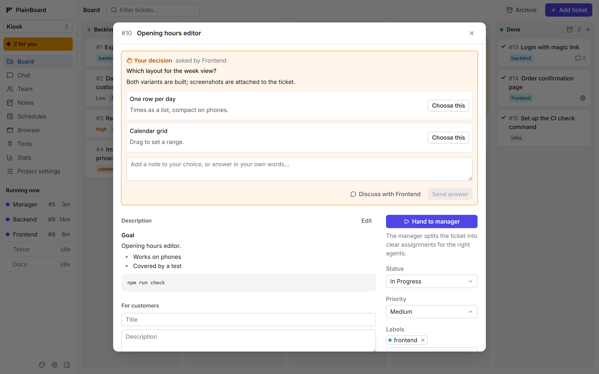
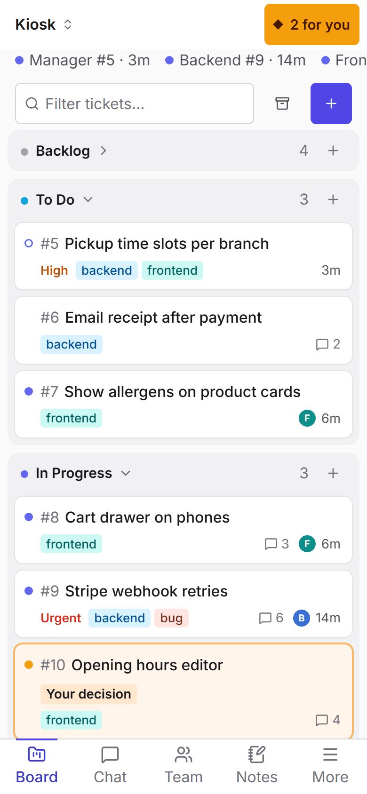
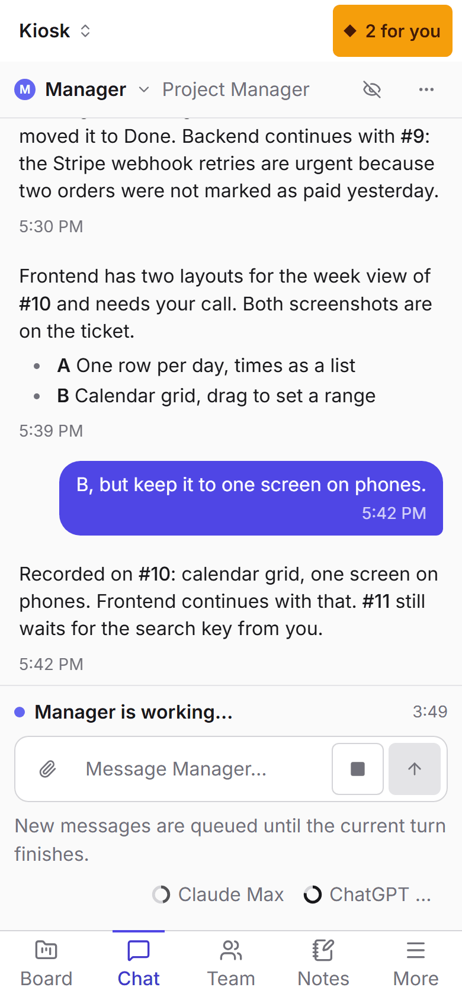
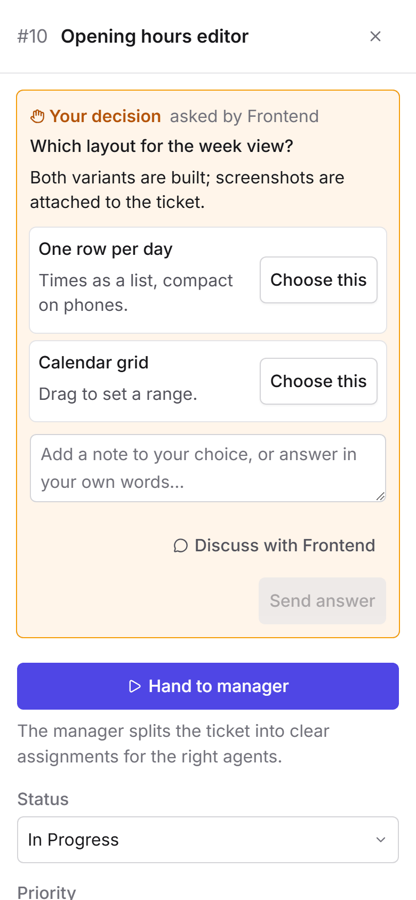
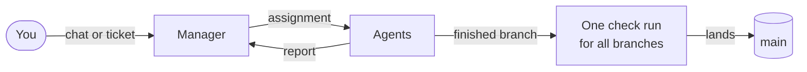

<div align="center">


# PlainBoard

**A Kanban board and a chat for your team of AI agents. Self-hosted, started with one command.**

You say what you want. A manager agent plans the tickets, hands each one to a specialised agent,<br>
and PlainBoard lands the finished work.

[](https://github.com/hthoene/plainboard/actions/workflows/ci.yml)
[](LICENSE)

[Quick start](#quick-start) · [How it works](#how-it-works) · [Configure](#configure) · [Guide](docs/guide.md) · [Architecture](ARCHITECTURE.md)

<picture>
  <source media="(prefers-color-scheme: dark)" srcset="docs/screenshots/board-dark.png">
  
</picture>

</div>

## What you get

- **A board that shows who is doing what.** Every ticket shows which agent works on it and for how
  long. Tickets take Markdown, labels, priorities, attachments and comments.
- **A manager you talk to.** It plans the tickets, builds the team, gives each ticket to one agent as
  a complete assignment, reads the reports and moves the tickets.
- **Your decisions, one click away.** When an agent needs a call from you, the ticket says so. Pick an
  option, answer in your own words, or discuss it in the chat.
- **A team per project.** Each agent has a role, a model, an effort level and its own tools. Claude
  and Codex work side by side, on API keys or on your subscriptions.
- **No agent waits.** Agents hand over finished branches; PlainBoard merges them into one train,
  checks it once and lands what passes. Ten changes cost one check run, not ten.
- **Small contexts, low cost.** An agent starts every ticket with a fresh context, and long chats are
  compressed with a cheap model.
- **Notes, schedules, MCP servers, git repositories.** All optional; without git everything works
  locally.
- **Desktop and phone, two designs, dark and light.** Installable as an app.

<table>
  <tr>
    <td width="50%">
      <picture>
        <source media="(prefers-color-scheme: dark)" srcset="docs/screenshots/chat-dark.png">
        
      </picture>
    </td>
    <td width="50%">
      <picture>
        <source media="(prefers-color-scheme: dark)" srcset="docs/screenshots/ticket-dark.png">
        
      </picture>
    </td>
  </tr>
  <tr>
    <td><b>Chat.</b> Every conversation, what waits for you, what the manager handed out, and how full your plans are.</td>
    <td><b>Decisions.</b> An agent asks, you choose. The ticket stays marked until you have.</td>
  </tr>
</table>

<p align="center">
  <picture>
    <source media="(prefers-color-scheme: dark)" srcset="docs/screenshots/phone-board-dark.png">
    
  </picture>
  &nbsp;
  <picture>
    <source media="(prefers-color-scheme: dark)" srcset="docs/screenshots/phone-chat-dark.png">
    
  </picture>
  &nbsp;
  <picture>
    <source media="(prefers-color-scheme: dark)" srcset="docs/screenshots/phone-ticket-dark.png">
    
  </picture>
</p>

## Quick start

You need Docker with Docker Compose.

```bash
git clone https://github.com/hthoene/plainboard.git
cd plainboard
docker compose up -d --build
```

Open <http://localhost:8080>, then:

1. **Settings → Claude**: paste an [Anthropic API key](https://console.anthropic.com/) and test the
   connection. Your own Claude login works too.
2. **Create a project** and tell the manager what you want, or add tickets and drag them to
   *In Progress*.

Optional: sign in to **Codex** with a ChatGPT subscription or an OpenAI key, and add a **GitHub**
token so agents can push branches and open pull requests. Both are under Settings.

## How it works



- **You never assign a ticket to an agent.** You hand it to the manager, which splits it into clear
  assignments for the right agents.
- **One agent owns a change** from the first line to handing it over, and reports once, when it is
  really finished.
- **Waiting is not agent work.** Check runs, merges and polling are done by PlainBoard without a
  model. If a train fails, it is cut in halves until the branch that breaks it is found.

## Configure

Everything is optional. Copy `.env.example` to `.env` for the settings below.

| You want to | How |
| --- | --- |
| Let agents work in a folder on your machine | Set `PLAINBOARD_WORKSPACES_DIR` and the project's **Local folder** |
| Run it on a server | Set `PLAINBOARD_BIND=0.0.0.0` and `PLAINBOARD_PASSWORD`, behind a reverse proxy with TLS |
| Look at what agents built | Their web servers open at `/preview/<port>/`, behind the PlainBoard password |
| Show progress on your website | Create a key under **Project settings → Public API** |
| Use several subscriptions | Add more accounts under Settings; agents move to the one with the most room |
| Change the look | The palette button: two designs, each light and dark. Your own is one stylesheet, see [ARCHITECTURE.md](ARCHITECTURE.md) |

The [guide](docs/guide.md) has the details for each of these.

## Good to know

- Agents have full control of the **runner** container: shell, passwordless sudo, network. They
  cannot touch the app container. Only give them credentials you are comfortable with.
- An Anthropic API key is the officially supported way to use the Claude Agent SDK. Whether you may
  use your own Claude login or ChatGPT subscription depends on the provider's terms for your plan;
  check them before relying on it. PlainBoard is not affiliated with Anthropic or OpenAI.
- Secrets are encrypted at rest with a key generated in the `data` volume.

## Development

```bash
# backend and runner tests
docker compose build app runner
docker run --rm -w /src/app --entrypoint python plainboard-app -m pytest -q
docker run --rm -w /src/runner plainboard-runner python -m pytest -q

# frontend with hot reload, proxies /api to a running stack on :8080
cd frontend && npm install && npm run dev
```

[ARCHITECTURE.md](ARCHITECTURE.md) explains the design and the extension points,
[DESIGN.md](DESIGN.md) the look.

## License

[MIT](LICENSE)
